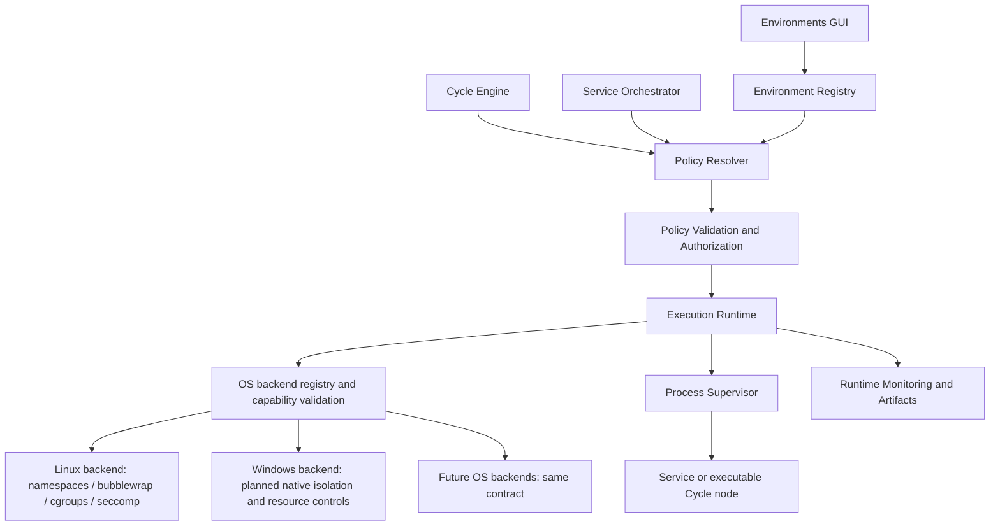

# QAVector — Environments & Execution Runtime

> Technical specification / architecture proposal  
> Status (2026-10-20): restrictions on a project folder - network, files and limits for Services and Cycle steps, set as project defaults with per-service/step values and quick toggles - are implemented on Linux; see [restrictions](restrictions.md). The stricter isolation from a reviewed file image below is available from the command line only. Windows execution, endpoint-level network rules and browser isolation remain planned.

**Current delivery scope, clarified by the user (2026-10-19):** existing Cycles
and Services continue to run as before. Do not migrate them, rewrite their
configurations or require a migration decision. Runtime is selected explicitly;
existing opt-in adapters remain available. Service/Cycle migration and wholesale
conversion of remaining execution paths are a separate task, excluded from this
delivery's completion criteria. Backward compatibility remains required. Windows
native implementation is also deferred; this delivery includes interfaces/stubs.
The broader architecture below describes the extension path, not authorization
to migrate existing workloads.

Implementation update (2026-10-19): native offline Linux execution includes
scoped file secrets, redacted streaming output, durable audit and service ownership.
Attached Python/shell Services can select a revision-pinned environment in GUI
Edit, adjust inherited rights/quotas and use compact controls with explicit
Save/restart and Undo/Redo. Actual policy is kept separate from pending edits.
Cycle `command.shell` and local `git.checkout` use the common runtime with narrowing cycle/node policies,
policy-bound approvals/Resume and detailed/compact GUI controls.
`agent.review` can use an explicitly approved JSON provider with RO mounts and
bounded scratch; acceptance currently uses a deterministic local fixture.
Scoped provider credentials can use declared Cycle secrets and native ephemeral
read-only files. Controlled egress and real remote provider acceptance remain planned.
Other Cycle
workers, Windows and restricted network enforcement remain planned.
Superseded for everyday use by [restrictions on a project folder](restrictions.md).

Mandatory distribution gates: [ER-BB-001](QAVector_Bundled_Bubblewrap_Requirement.md)
and [ER-LIC-001](QAVector_Bubblewrap_License_Requirement.md).

The implementation plan and acceptance reports are kept outside the repository.

## 1. Purpose

Introduce a unified, configurable execution environment for QAVector services and **every executable Cycle node**, with OS-enforced isolation, resource quotas, network policies, and observable execution. The solution must preserve existing launch, Cycle, plugin, and artifact behavior unless changes are explicitly approved.

**Terminology**

- **Environments** — user-facing configurations and GUI area.
- **Execution Runtime** — platform subsystem responsible for applying policies and executing workloads.
- **Isolation Engine** — OS-specific backend used by Execution Runtime.
- **Execution Policy** — declared access rights and resource limits.
- **Execution Instance** — one concrete launched process/job with an effective, immutable policy.

The term **Execution Isolation** describes the overall capability. **Service Isolation** and **Cycle Node Isolation** are two uses of the same mechanism.

## 2. Main scenarios

### 2.1 Service Isolation

Services started from QAVector (Odoo, PostgreSQL, Flask, Python, scripts, etc.) must not automatically see the host filesystem or consume unrestricted CPU, RAM, process slots, or network access. The service receives only explicitly allowed mounts, required runtime dependencies, endpoints, and quotas.

### 2.2 Cycle Node Isolation

**Any executable Cycle node**, regardless of type (`agent`, `git`, `command.shell`, `script`, `test`, `plugin`, and future nodes), must run under an effective Execution Policy. This policy controls file, network, process, resource, tool, and credential access. Child processes must not escape the boundary. A plugin cannot silently bypass policy by executing commands in the unrestricted QAVector host process.

Some nodes are pure orchestration or metadata-only and do not spawn processes. Such nodes still require authorization checks for any external capabilities they invoke (e.g. Jira transitions, repository writes, model/provider API access).

### 2.3 Example: one-project Cycle

A Cycle bound to `/home/user/projects/app-a` can execute Git operations, code generation, reviews, shell commands, and tests in that project. It must not be able to read `/home/user/.ssh`, `/home/user/Documents`, or `/home/user/projects/app-b`. Node-specific policies can further restrict a reviewer to read-only access and a test node to a separate writable scratch directory.

## 3. Design principles

1. **Deny by default:** host paths, network, privileged operations, and secrets are unavailable unless explicitly granted.
2. **OS-enforced boundaries:** do not rely on prompts, Python path checks, or plugin conventions as security boundaries.
3. **Node-type independence:** execution policy belongs to an execution instance, not to an `agent` implementation.
4. **Least privilege:** a child node's effective permissions are no broader than its Cycle ceiling; stricter node rules are allowed.
5. **Separation of control and execution:** the trusted QAVector control plane provisions environments; untrusted workloads cannot edit or approve their own policy.
6. **Explicit compatibility:** an unrestricted compatibility mode, if retained, is highly visible, opt-in, and never implied for untrusted execution.
7. **Auditable and reproducible:** record requested/resolved policy, runtime backend, mounts, quotas, and notable denials (where detectable).
8. **Fail closed:** if a required isolation capability is unavailable, do not silently run without isolation.
9. **Cross-platform contract:** one OS-neutral Execution Runtime interface, policy model and lifecycle; separate native backends for Linux, Windows and future operating systems. Ubuntu is a possible Linux test distribution, not an architectural dependency. Windows extensibility is a requirement from the first implementation increment.

## 4. Proposed architecture



### 4.1 Core components

| Component | Responsibility |
|---|---|
| Environment Registry | Store named environment profiles, versions, inheritance, and ownership |
| Policy Resolver | Merge platform restrictions, project/Cycle ceilings, environment profile, and node-specific restrictions |
| Policy Engine | Validate access, external operations, network/secret grants, and privilege escalation constraints |
| Execution Runtime | Materialize a validated environment and launch/stop/restart processes |
| Backend Registry | Select and lazily load an OS-compatible provider without weakening required policy guarantees |
| Isolation Engine | Implement the common access/isolation guarantees using native OS mechanisms; expose verified capabilities and unsupported requirements |
| Resource Controller | Enforce and inspect resource limits using the selected OS backend with explicit units, scope and accounting semantics |
| Process Supervisor | Common lifecycle contract for process trees, exit status, cancellation, restart and cleanup; native signaling and containment stay in OS backends |
| Runtime Monitoring | Emit usage metrics, policy metadata, execution logs, and artifacts |

### 4.2 Execution lifecycle

```mermaid
sequenceDiagram
    participant C as Cycle/Service
    participant P as Policy Resolver
    participant R as Execution Runtime
    participant I as Isolation Backend
    participant M as Monitoring
    C->>P: Request execution + project/Cycle/node policy
    P->>P: Compute effective policy; verify ceiling
    P-->>R: Immutable approved policy
    R->>I: Create restricted instance
    I-->>R: Ready or explicit failure
    R->>M: Start metrics and policy record
    R->>I: Launch workload inside boundary
    I-->>R: Exit / termination
    R->>M: Persist result, logs, metrics
    R->>I: Cleanup resources
```

### 4.3 Cross-platform backend contract

`RuntimeBackend` provides the same versioned operations on every supported OS:
`capabilities`, `preflight`, `prepare`, `start`, `stop`, `wait`, `inspect`, and
`cleanup`. Services, Cycle plugins, GUI, policy resolution, approvals and
integration authorization depend on this contract. OS detection and native
imports belong to the backend registry and implementations, not business plugins.

The shared policy describes required guarantees: filesystem grants, network mode,
descendant containment, privilege restrictions and resource ceilings. Linux
namespaces/seccomp/cgroups and Windows security tokens/Job Objects are backend
mechanisms, not mandatory fields of the portable policy. Backend-specific options
must be namespaced, versioned and strictly validated; a different provider cannot
silently ignore them.

Capabilities describe actual enforcement, constraints and unsupported reason
codes. A provider must reject a required guarantee that it cannot implement;
portability must not reduce isolation to the weakest supported OS. Resource units
and accounting must be explicit: process counts versus threads, resident versus
committed memory, and CPU core quota versus system CPU percentage cannot be
silently substituted.

Host and workload paths use trusted logical workspace/dependency bindings with
platform-specific mapping and validation. POSIX mount targets are Linux examples,
not universal paths; Windows handling must account for drive/UNC/device paths,
case semantics and junction/reparse points. Shared models and protocol must import
and run on Windows without POSIX dependencies. Linux and Windows contract CI is
required from the first increment, before native Windows isolation is available.

## 5. Policy model and inheritance

Policy layers should be applied from most authoritative to most specific:

```text
Platform security baseline
  └── Project permissions / workspace scope
       └── Cycle maximum permissions (ceiling)
            └── Environment profile
                 └── Node-specific restrictions
                      └── Effective execution policy
```

**No layer may widen an upper-layer restriction.** Mounts, tools, secret grants, and network allowances are validated against the parent ceiling. Resource ceilings use the stricter value; explicit denial prevails over an allowance. Policy conflicts must cause validation errors rather than permissive fallback.

Example:

| Workload | Filesystem | Network | Privileged capabilities |
|---|---|---|---|
| Git node | Workspace RW; Git metadata as needed | Approved Git remote only | Git operations within approved repository |
| Developer agent node | Workspace RW | Model endpoint via broker | Approved tools only |
| Reviewer agent node | Workspace RO | Model endpoint via broker | Read/analysis tools |
| Shell node | Workspace RO or RW by policy | Disabled by default | Executable/argument restrictions as configured |
| Test node | Workspace RO + scratch RW | Explicit test dependencies | Run tests, collect artifacts |
| PostgreSQL service | Data directory RW | Local application network | DB daemon only |

**Important:** limiting a binary by filename is not equivalent to sandboxing; all tools, subprocesses, and launched runtimes must remain in the OS boundary.

## 6. Example configurations

The following YAML defines the **proposed QAVector schema**, not an existing implementation.
The Linux profile, namespace options and POSIX workload paths below illustrate
one backend. The final common schema must separate portable guarantees from
OS-specific options and path bindings as required by section 4.3.

### 6.1 Reusable environment profile

```yaml
api_version: qavector.io/v1
kind: ExecutionEnvironment
metadata:
  name: project-development
spec:
  provider: linux-isolated
  isolation:
    filesystem:
      default: deny
      mounts:
        - source: ${PROJECT_ROOT}
          target: /workspace
          access: read_write
      scratch:
        path: /tmp
        size_mb: 512
    processes:
      isolate_pid: true
      isolate_user: true
      no_new_privileges: true
    network:
      mode: none
    resources:
      cpu_quota: 2.0
      memory_limit_mb: 2048
      pids_limit: 100
  working_directory: /workspace
```

Runtime/system dependencies (executables, libraries, CA certificates, optional DNS, etc.) must be provided through a verified runtime root or narrowly scoped read-only mounts. Avoid automatically binding `/home` or the host root.

### 6.2 Service isolation

```yaml
service:
  id: odoo-dev
  command: ["python3", "odoo-bin", "-c", "odoo.conf"]
  environment: odoo-service
  overrides:
    isolation:
      filesystem:
        mounts:
          - source: ${PROJECT_ROOT}
            target: /workspace
            access: read_write
          - source: ${ODOO_DATA}
            target: /var/lib/odoo
            access: read_write
      resources:
        cpu_quota: 4.0
        memory_limit_mb: 4096
        pids_limit: 200
      network:
        mode: restricted
        outbound:
          - target: postgres-dev
            port: 5432
            protocol: tcp
```

`restricted` network access requires a network namespace plus a dedicated, enforceable network policy layer (for example firewall rules, proxy/egress broker or controlled virtual networking). **Bubblewrap alone does not implement hostname/port allowlists.** Hostnames must be resolved and revalidated safely; policy must account for DNS changes and IPv4/IPv6.

### 6.3 One-project Cycle with heterogeneous nodes

```yaml
cycle:
  id: feature-development
  project: app-a
  execution:
    environment: project-development
    policy_ceiling:
      filesystem:
        workspace: ${PROJECT_ROOT}
        access: read_write
      network:
        permitted_services: [git-proxy, model-proxy]
      resources:
        memory_limit_mb: 4096
        cpu_quota: 4.0
  nodes:
    - id: fetch
      type: git
      action: fetch
      execution:
        network:
          permitted_services: [git-proxy]
    - id: implement
      type: agent
      depends_on: [fetch]
      execution:
        filesystem:
          workspace_access: read_write
        network:
          permitted_services: [model-proxy]
    - id: inspect
      type: command.shell
      depends_on: [implement]
      command: ["git", "diff", "--check"]
      execution:
        filesystem:
          workspace_access: read_only
        network:
          permitted_services: []
    - id: verify
      type: test
      depends_on: [inspect]
      execution:
        filesystem:
          workspace_access: read_only
          scratch_write: true
        network:
          permitted_services: []
```

The concrete schema and interpolation rules must be settled after studying current Cycle and plugin formats. Placeholder values such as `${PROJECT_ROOT}` must resolve to trusted platform metadata, not untrusted node-controlled strings.

## 7. OS-specific isolation implementations

### 7.1 Linux backend — first native implementation

**Recommended initial backend:** Bubblewrap + Linux namespaces, backed by cgroups v2 and seccomp; a dedicated launcher/broker sets up restrictions before executing the workload.

- **Filesystem:** separate mount namespace, minimal runtime root, allowlisted read-only/read-write bind mounts, scratch tmpfs, no host root exposure.
- **Processes:** user and PID namespace where supported, drop privileges/capabilities, `no_new_privs`, seccomp, correct subprocess inheritance, process-group/cgroup cleanup.
- **Resources:** cgroups v2 `cpu.max`, `memory.max`, `pids.max` with monitoring and termination/cleanup handling; account for thread and subprocess counts.
- **Network:** `--unshare-net` for no network; explicit virtual networking/proxy/firewall for restricted access; prevent access to host or container control sockets unless intentionally authorized.
- **Filesystem hardening:** prevent path traversal/escaping through symlinks, unsafe mounts, inherited descriptors, device nodes, `/proc`, and writable runtime directories.
- **Secrets:** grant scoped credentials via trusted broker or controlled ephemeral delivery; never implicitly forward host SSH agent, cloud credentials, environment secrets, or API keys.

**Operational constraints:** Linux user namespaces and cgroup delegation vary by distribution and machine policy. Detect capabilities at startup and expose unsupported options in GUI. Disabling isolation must not be an automatic fallback. Bubblewrap is not a VM and does not protect against every kernel vulnerability.

### 7.2 Windows backend — planned implementation path

Windows implements the same `RuntimeBackend` interface and uses the same policy,
worker protocol, gateway and service/Cycle adapters. It does not reuse a Linux
launcher or require Ubuntu/WSL as the definition of native Windows support.

1. Prototype the security boundary with AppContainer and scoped filesystem access;
   verify RO/RW workspace semantics, system-resource access, registry, named pipes,
   credentials and junction/reparse escape cases. Job Objects alone do not establish
   the required filesystem/network boundary. Reject unsupported guarantees or
   design a separately identified container/VM provider if native primitives
   cannot satisfy them.
2. Implement process ownership and resource control using Job Objects: explicit
   CPU/memory/active-process semantics, descendant containment, breakaway prevention,
   bounded termination and cleanup. Apply security and job assignment before user
   code starts, and verify handle inheritance and nested-job behavior.
3. Implement and verify network-disabled mode; evaluate WFP or a broker for
   restricted networking with explicit installation/privilege requirements.
4. Run the same service, Git, command, agent-fixture and test-command acceptance
   scenarios on Windows; validate shell/argv paths, packaging and browser support
   separately. Publish supported Windows builds/editions and capability gaps.

This is a design direction to validate, not a claim of existing Windows enforcement
or equivalence between Windows and Linux resource accounting. Native reference
material: [AppContainer isolation](https://learn.microsoft.com/en-us/windows/win32/secauthz/appcontainer-isolation),
[Job Objects](https://learn.microsoft.com/en-us/windows/win32/procthread/job-objects),
[CPU rate control](https://learn.microsoft.com/en-us/windows/win32/api/winnt/ns-winnt-jobobject_cpu_rate_control_information),
[job memory limits](https://learn.microsoft.com/en-us/windows/win32/api/winnt/ns-winnt-jobobject_extended_limit_information),
[Windows Filtering Platform](https://learn.microsoft.com/en-us/windows/win32/fwp/windows-filtering-platform-start-page),
[reparse points](https://learn.microsoft.com/en-us/windows/win32/fileio/reparse-points).

### 7.3 Backend availability

A missing or incomplete OS backend returns structured unsupported diagnostics
before workload execution. An explicitly selected `trusted-host` compatibility
provider is separate and never an automatic fallback. Future OS backends follow
the same interface and capability tests without changes to shared clients.

## 8. External integrations and agent tool calls

Filesystem namespaces cannot govern remote Jira/GitHub operations or cloud APIs. Introduce a **Capability/Integration Gateway** that authorizes each external operation against the effective execution policy. Examples:

- Repository read vs push, allowed remotes/branches.
- Jira project access and permitted transitions.
- Model/API provider access and spending/rate limits where supported.
- Scoped tokens, secret masking and revocation.
- Tool invocation via an approved gateway rather than unrestricted calls executed by the host control process.

A remote cloud agent's internal execution is not protected by local Linux namespaces. Scope its inputs, credentials, tools, and outputs and enforce the operations that QAVector performs on its behalf.

## 9. GUI: Environments

Add a first-class **Environments** section rather than naming the user-facing feature Sandbox Manager.

### 9.1 Environment list

Show name, backend, usage (services/Cycles), filesystem access summary, network mode, resource quotas, verification status, and last validation result. Provide Create, Duplicate, Edit, Validate, and Inspect Effective Policy actions.

### 9.2 Environment editor

Tabs/sections:

1. **General:** environment name, description, execution provider, immutable version/revision.
2. **Filesystem:** mounts, read-only/read-write flags, workspace mapping, scratch storage.
3. **Resources:** CPU quota, RAM, PID limit; optional disk IO/space limits if backend supports them.
4. **Network:** disabled, restricted, trusted/full; explicitly listed permitted services/endpoints.
5. **Security:** namespaces, capabilities, seccomp, credential/tool grants.
6. **Diagnostics:** policy validation, effective-permissions preview, runtime compatibility, audit logs.

### 9.3 Cycle editor and service setup

- Each service and executable node has an **Execution Environment** selector.
- Cycle-level policy is visible as a ceiling; node editor shows only narrowing options.
- Clearly distinguish runtime isolation settings from node business configuration (e.g., Git `fetch`, shell command, agent model).
- Display effective policy, inherited restrictions, and conflicts **before** running.
- An executed node's inspector exposes actual mounts, network policy, quotas, resource use, and exit reason.
- Existing cycles and services without an explicit Runtime configuration keep their current execution behavior without a migration prompt. Environment selection is opt-in; migration is a separate task.

### 9.4 Detailed settings in Service and Node Edit

Extend the existing service Edit dialog and Cycle Node Edit dialog with an
Execution Environment section/tab. Include profile selection, inherited grants,
network mode/endpoints, filesystem RO/RW/scratch, resource limits and effective
permissions preview. Node controls may only narrow the Cycle ceiling. Keep native
backend diagnostics in advanced details; ordinary controls use the common policy
model on Linux and Windows.

Editing a service/node creates a local override. Changing a shared environment
profile is a separate, explicitly named action showing its affected consumers.

### 9.5 Compact quick controls on service rows and Cycle nodes

Provide direct access to frequent properties without opening the full editor:

- **Network:** a compact stateful icon/button to disable network access or restore
  the last permitted profile mode; a small menu exposes the allowed modes and
  endpoints. Enabling restricted access must preserve its endpoint allowlist.
  Inherited denial disables enablement with an explanation; never implicitly grant
  unrestricted network. Offer an explicit Inherit action, distinct from Off.
- **Workspace:** show RO/RW for the main workspace, with a quick change only within
  inherited grants; individual paths and scratch remain in detailed settings.
- **Resources:** a compact popover/menu for CPU/RAM/process presets or exact limits;
  avoid a separate persistent button for every quota.
- **Environment/settings:** show the profile/effective permissions and open Edit
  directly at its Execution Environment section.

Service rows keep a compact single-line action group using existing icons/theme.
Network state and direct runtime-settings access remain visible; secondary actions
can use an overflow menu. Cycle nodes show small persistent network/workspace
indicators and expose actions on selection, hover or focus; the inspector and
context menu provide the same actions with labels. Preserve graph titles, status,
timers, ports, dragging and low-zoom readability.

Use tooltips, accessible names, keyboard focus and glyph/text state distinctions;
color alone is insufficient. Locked, unsupported, inherited, override, unsaved
and pending states must be recognizable without expanding every editor.

### 9.6 Apply and persistence semantics

Detailed editors, quick controls and inspectors use one shared state/validation
model. A quick edit uses the existing service Save or Cycle Draft/Save/Undo flow;
it does not silently rewrite shared profiles or alter neighboring workloads.
Validation/save conflicts do not appear as successful policy changes.

An execution instance keeps its immutable effective policy. For a running service,
show actual permissions separately from requested settings marked After restart;
provide an explicit Apply and restart action through core preflight and supervised
restart. A quick toggle alone does not restart the service or claim that network
access has already changed.

For Cycle nodes, distinguish the current run's effective policy from edits for the
next run. Updating an unstarted node in the active run requires a supported core
revision, revalidation and renewed approval binding; a definition edit alone must
not change pending/running/retry/poll executions. Running nodes require a new
authorized execution to change permissions. Historical/replay controls are read-only.

## 10. Monitoring, logs, and artifacts

For each service or Cycle execution instance capture:

- Environment profile/version and effective policy hash/snapshot.
- Runtime backend and isolation feature status.
- Native process/resource-container identifiers in backend diagnostic metadata (internal only as appropriate), lifecycle events, exit code and failure reason; common clients do not depend on Linux cgroup or Windows Job Object details.
- CPU, RSS/memory, PIDs/threads, and optional IO/network metrics over time.
- Standard output/error and application logs with secret redaction.
- Audit events for rejected execution requests and enforceable authorization denials.

OS-level filesystem denials may manifest as ordinary `ENOENT` or `EACCES` and cannot necessarily be individually audited without additional tracing. Do not claim complete forensic visibility by default.

Reuse QAVector's existing Analytics and Artifacts capabilities where practical; avoid building parallel reporting stores.

## 11. Reliability and compatibility

- Isolated process launch must not block the GUI event loop.
- Correct stop/restart: wait for process and descendants to terminate, release resources, then relaunch; avoid overlapping service instances.
- Handle failure before launch, while running, on cancellation, and during host shutdown.
- Preserve existing Cycle node/plugin contract where possible through a shared execution adapter.
- Maintain Playwright/Chrome session support; browsers may require separately validated namespaces, shared memory, display sockets, and network access. Never silently expose the desktop session or host filesystem.
- Backend abstraction must support separate Linux and Windows implementations through one common interface from the first increment; future OS, OCI/container and remote providers use the same contract. Do not introduce Linux assumptions into shared policy, paths, lifecycle or GUI.

## 12. Proposed phased implementation

### Phase 1 — Architecture and proof of concept

1. Audit current Service, Cycle, node/plugin, agent, execution, and reporting paths.
2. Identify every entry point that starts a process or invokes an external capability.
3. Implement immutable OS-neutral policy resolution, backend/capability/path contracts and shared Linux/Windows contract tests.
4. Prototype Bubblewrap filesystem isolation on Linux with explicit capability checks; Ubuntu may be one test distribution. Define and spike the native Windows backend against the same interface and acceptance guarantees.
5. Test one service and heterogeneous Cycle nodes (`git`, `command.shell`, `agent`, `test`).

### Phase 2 — Controlled local execution

1. Introduce the shared Execution Runtime adapter and first Linux backend; keep service/Cycle clients backend-independent.
2. Integrate native resource controllers for limits and cleanup: cgroups v2 in Linux, Job Objects in the planned Windows track with explicit accounting differences.
3. Implement network-disabled mode and secure credentials handling per OS; progress native Windows access isolation through its own verified capability matrix.
4. Add service/node profile assignment and inheritance validation.
5. Implement lifecycle, logging, policy snapshot, and runtime metrics.

### Phase 3 — Network and integration authorization

1. Build restricted networking backend and verify actual egress enforcement.
2. Add Capability/Integration Gateway for plugins, remote APIs and agent tools.
3. Add policy audit diagnostics and explicit escape/failure testing.
4. Expand compatibility matrix for Odoo, PostgreSQL, Flask, Git, Python and browser testing.

### Phase 4 — Productization

1. Environments GUI and Cycle/node environment selector.
2. Reusable profile templates. Migration workflow for existing Services/Cycles is a separate task outside the current delivery.
3. Documentation, automated integration/security tests and diagnostics.
4. Performance regression testing, packaging, platform requirements and release rollout.

## 13. Acceptance criteria

1. A service with access to Project A cannot read or modify a non-mounted Project B or host `.ssh` directory.
2. An `agent`, `git`, `command.shell`, `test` or `plugin` node cannot expand filesystem access beyond the Cycle policy ceiling.
3. Tools and child processes spawned by a node remain inside the same or stricter runtime boundary.
4. A read-only node cannot modify the project, and has a separately specified scratch directory if needed.
5. Resource limits are actually enforced via kernel primitives, not merely shown in configuration.
6. Network-disabled workloads have no unauthorized outbound access; restricted network claims are tested at the network layer.
7. External plugin/API operations are individually authorized and use only scoped credentials.
8. Missing capabilities, unsupported configurations, and policy conflicts **fail closed** with actionable diagnostics.
9. Stop/restart leaves no orphan process or stale resource allocation.
10. Runtime artifacts contain effective policy and resource history, with appropriate secret masking.
11. Existing working services, Cycle nodes, plugin system, and browser reports do not regress.
12. Security tests cover symlinks, mount escapes, inherited file descriptors, Unix sockets, privilege escalation attempts, malicious subprocesses and unexpected network access.
13. Shared runtime/policy/worker/GUI contracts remain OS-neutral and are tested on Linux and Windows from the first increment. A Windows provider can be added without changing service/Cycle business logic; native Windows enforcement requires its own real integration tests, including reparse points, inherited handles, named pipes and process-job escape cases.
14. Service and Cycle Node Edit expose detailed runtime settings; compact controls on service rows and graph nodes provide consistent network/workspace/resource access within inherited grants. Tests verify draft/save/undo behavior, disabled/unsupported states, accessibility, actual versus pending permissions, controlled restart and real enforcement after application.

## 14. Open design decisions

- Whether a Cycle shares one workspace mount with nodes or each node receives an isolated writable working copy/overlay; the latter is safer for concurrent/reviewer/test steps.
- Which node capabilities require OS process execution versus trusted API/broker authorization.
- Whether a restricted network proxy is local, per-project, or per-runtime instance.
- Where environment profiles are stored, versioned, and approved, and who can change policy ceilings.
- How project path mapping interacts with nested Git repos, submodules, worktrees, and generated artifacts.
- Whether untrusted third-party plugins may execute in the QAVector host process at all (recommended: no).
- Which native Windows mechanisms meet each required guarantee, which Windows builds/editions/privileges are supported, and whether any stronger policy requires a separate container/VM provider. The common interface and planned Windows expansion are requirements, not open design decisions.

## 15. Guidance for implementation agent

**Preserve existing Service/Cycle execution; migration is a separate task.** First inspect the repository, document current entry points/contracts, and propose the smallest compatible opt-in integration path. Present an interface-level design, risks, and test matrix before significant refactoring. Distinguish implemented OS enforcement from declarative settings or aspirational features. Add security regression tests for at least one explicitly configured service and multiple distinct Cycle node types before considering the Runtime feature complete. Do not make conversion of existing workloads a completion prerequisite.
