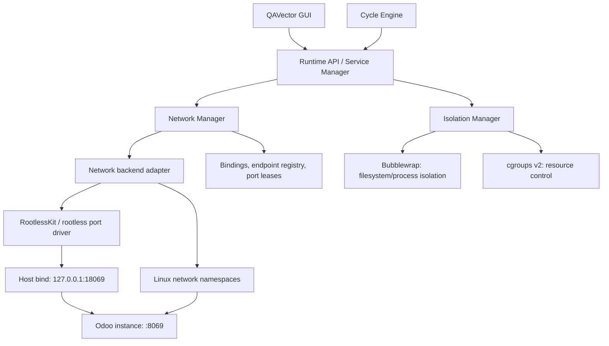

# QAVector — Network Isolation & Port Publishing

**Status:** Architecture proposal / implementation specification  
**Scope:** Service Manager, Isolation Manager, Network Manager, Cycle Runtime, GUI  
**Goal:** Isolate ports for concurrently running services while allowing controlled access to selected internal endpoints, including dynamic publishing during a Cycle Run.

## 1. Context and goals

QAVector runs local services (e.g., Odoo, PostgreSQL, Redis) and orchestrates them through Cycles. Multiple instances may need the **same internal port** (for example, several Odoo instances on `8069`). Services should not compete for host ports or receive unrestricted network access by default.

Deliver:

- A **network namespace per isolated service/runtime instance** so internal ports can overlap.
- Explicit, revocable **host port publishing** (`host_ip:host_port → isolated_service:internal_port`).
- Both **static** (declarative) and **dynamic** (runtime API/GUI/Cycle node) publishing.
- **Run-scoped networks and leases**, so parallel Cycle Runs are independent.
- Controlled **private communication** between authorized services without publishing their ports on the host.
- Rootless operation where practical, no Docker dependency, and actionable status in the GUI.

**Non-goal for v1:** implement a complete container network stack, generalized overlay networks, ingress routing, or production-grade service mesh.

## 2. Terminology and ownership

| Entity | Responsibility |
| --- | --- |
| Project | Logical grouping of resources and definitions; does not imply a shared network namespace. |
| Service definition | Reusable command, resource settings, networking policy and default publish rules. |
| Service instance | A concrete running process with its own network context and runtime identity. |
| Cycle definition | Declarative orchestration graph; may request access to services or publish ports. |
| Cycle Run | Execution instance, owns temporary service instances and port leases when configured. |
| Network Manager | Creates/manages network contexts, publishing, connectivity policies and cleanup. |
| Port publication | A controlled binding of an address/port on the host to an isolated service endpoint. |

**Important distinction:** a service's private port is not automatically available on the host or inside another service. `127.0.0.1` means a different loopback address in each network namespace.

## 3. Architecture



**Integration constraint:** Bubblewrap `--unshare-net` creates an isolated network namespace with no automatically configured network connectivity. The rootless networking backend must create/configure the namespace and forwarding path, and the service must run *in that same network namespace*. Do **not** run independent `--unshare-net` calls in nested launchers and assume they share a network. A controlled launcher should coordinate RootlessKit, Bubblewrap and the process lifecycle, with explicit tests for compatibility.

Recommended adapter interfaces:

```python
class NetworkBackend(Protocol):
    async def create_context(self, instance_id: str, policy: dict) -> str: ...
    async def start_in_context(self, context_id: str, command: list[str]) -> int: ...
    async def publish(self, context_id: str, rule: dict) -> dict: ...
    async def unpublish(self, publication_id: str) -> None: ...
    async def list_publications(self, context_id: str) -> list[dict]: ...
    async def destroy_context(self, context_id: str) -> None: ...
```

This is a conceptual interface: exact process launch ownership may remain with Service Manager as long as the namespace is preserved.

## 4. Network modes

| Mode | Description | Default |
| --- | --- | --- |
| `private` | Independent network namespace; no host publication. Outbound network access is explicitly configured. | **Yes** for isolated instances |
| `local` | Private namespace with one or more published endpoints bound to host loopback. | No |
| `public` | Private namespace with explicit binding to a host LAN/public interface. | No; approval required |
| `shared_group` *(later)* | Explicitly grouped services with a shared network context or private routing. Same namespace implies shared port space. | No |

`private` should not be interpreted as *automatically secure egress isolation*. Enforce outbound and host-loopback restrictions through the selected networking backend/policy.

## 5. Port publishing model

Examples:

```text
Host 127.0.0.1:18069  ->  Cycle Run A / Odoo :8069
Host 127.0.0.1:18070  ->  Cycle Run B / Odoo :8069
Host 127.0.0.1:15432  ->  PostgreSQL :5432
```

Configuration proposal:

```yaml
service:
  id: odoo_dev
  command: [python3, odoo-bin, --http-port=8069]

  isolation:
    enabled: true
    network:
      mode: private
      outbound: false
      allow_host_loopback: false
      publish:
        - id: web
          protocol: tcp
          internal_port: 8069
          host_ip: 127.0.0.1
          host_port: auto
          enabled: true
          scope: service_instance # or cycle_run
```

`auto` is an instruction to allocate a free port **at binding time**; the runtime must return and persist the *actual bound port*. Probing for a free port and releasing it before binding is race-prone.

**Binding behavior:** the service must listen on an address reachable by the network forwarding backend (often `0.0.0.0:8069` inside the namespace). Binding only to the service's private `127.0.0.1` may not work with a given forwarding driver; validate backend-specific behavior.

**Protocols:** TCP for v1; UDP only after integration tests and backend validation.

## 6. Dynamic publishing without service restart

Support calls:

```text
POST   /runtime/services/{instance_id}/ports
GET    /runtime/services/{instance_id}/ports
DELETE /runtime/services/{instance_id}/ports/{publication_id}
```

Example request:

```json
{
  "protocol": "tcp",
  "internal_port": 8069,
  "host_ip": "127.0.0.1",
  "host_port": "auto",
  "scope": "cycle_run"
}
```

Example response:

```json
{
  "publication_id": "pub_01",
  "instance_id": "svc_run_101_odoo",
  "host_ip": "127.0.0.1",
  "host_port": 18069,
  "internal_port": 8069,
  "protocol": "tcp",
  "status": "active"
}
```

The implementation can use a **RootlessKit-compatible port manager/API** if selected and validated for the target environment. Do not rely on assumed CLI flags or a hardcoded socket path: determine the actual backend's runtime API, process lifetime and port-driver capabilities during implementation.

An idempotent `unpublish` operation removes the host listener **without stopping the service**. Network context persists until the owning service or run ends.

## 7. Cycle Run integration

The same Cycle definition can run multiple times concurrently, with independent service instances and port bindings:

```text
Development Cycle
├── Run #101
│   ├── Odoo       8069 -> host 18069
│   └── PostgreSQL 5432 (private)
└── Run #102
    ├── Odoo       8069 -> host 18070
    └── PostgreSQL 5432 (private)
```

New optional node operations:

- `network.publish_port`: publish a service-instance endpoint and output the actual host address and port.
- `network.unpublish_port`: revoke an existing publication.

Illustrative Cycle step:

```yaml
steps:
  - id: expose_odoo
    type: network.publish_port
    with:
      service_instance: ${steps.start_odoo.instance_id}
      internal_port: 8069
      host_ip: 127.0.0.1
      host_port: auto
      protocol: tcp
      scope: cycle_run
    outputs: [publication_id, host_ip, host_port]

  - id: browser_tests
    type: browser.run_tests
    with:
      base_url: http://${steps.expose_odoo.host_ip}:${steps.expose_odoo.host_port}

  - id: close_odoo
    type: network.unpublish_port
    when: always
    with:
      publication_id: ${steps.expose_odoo.publication_id}
```

**Lifecycle requirement:** regardless of whether the final cleanup node runs, the runtime must revoke any run-scoped publications when the run completes, fails, is canceled, or crashes. On app restart, reconcile orphaned leases and network processes.

## 8. Private service-to-service communication

Example: Odoo needs PostgreSQL without publishing database port `5432` on the host.

Options to evaluate:

1. **Explicit shared network group:** simplest for Odoo + PostgreSQL if their ports do not conflict; shared `localhost` and shared port namespace. Not suitable when same-port services must coexist in a group.
2. **Per-service namespaces with controlled connectivity:** more flexible, but requires private addressing/routing, service discovery and ingress restrictions; potential rootless complexity.
3. **Unix domain socket:** for compatible services, expose a carefully permissioned socket through the filesystem isolation layer instead of TCP.

**Recommended v1:** make *direct host publishing* reliable first; implement one narrowly scoped private connectivity option next (shared network group or vetted socket approach). Avoid promising Docker-like DNS/service discovery until the network topology is actually implemented.

## 9. GUI specification

**Service → Network**

| Field | Example |
| --- | --- |
| Isolation | Enabled |
| Network mode | Private |
| Outbound internet | Disabled |
| Host loopback | Blocked |
| Internal endpoints | TCP 8069, 8072 |
| Published endpoints | `127.0.0.1:18069 → :8069` |

Actions: **Publish Port**, **Unpublish**, **Copy Address**, **Open in Browser**, **View Connections**.

For each publication show:

- Internal endpoint, host IP, assigned host port, protocol.
- Owner (service instance vs Cycle Run), status and creation time.
- Visibility warning (`local only` vs `LAN/all interfaces`).
- Error details for bind conflicts, backend errors or unavailable service.

Cycle Run execution view should display the actual URLs emitted by its publish nodes; never infer addresses from a fixed port mapping.

## 10. Security and operational requirements

- Default to **no host publication**, and prefer `127.0.0.1` binding for user-requested access.
- Require explicit confirmation/permission for `0.0.0.0` or non-loopback bindings.
- Explicitly evaluate IPv4 and IPv6 bindings; `127.0.0.1` does not cover `::1`.
- Prevent unauthorized publication of privileged/sensitive service endpoints such as PostgreSQL administrative interfaces.
- Do not assume publication adds TLS, authentication, authorization or firewall rules.
- Enforce rights per service instance and Cycle Run; an AI agent should not be able to publish ports by default without a policy grant.
- Keep network, filesystem, PID and cgroup isolation coordinated; a network namespace alone is **not** a full security boundary.
- Handle port conflicts atomically through the forwarding backend; report the actual error rather than silently choosing a different port for explicit mappings.
- Track lease ownership and clean up listeners, namespace processes, state directories and sockets after stop/crash.
- Record publish/unpublish operations in execution history and audit logs (without leaking credentials or secrets).

## 11. Implementation plan

### Phase 1 — Port isolation baseline

- Introduce service-instance IDs and network contexts.
- Prove two Odoo-like HTTP services can listen on `8069` simultaneously.
- Validate the combined Bubblewrap + rootless network launcher on Ubuntu 22.04 and supported Linux versions.
- Check behavior for loopback and non-loopback binds inside the namespace.

### Phase 2 — Publishing

- Build `NetworkBackend` / `NetworkManager` interface.
- Implement static localhost TCP publications and automatic host port selection.
- Add dynamic add/remove of port rules without restarting the service.
- Surface assigned addresses and conflicts in the GUI.

### Phase 3 — Cycle Run ownership

- Support run-scoped service instances and port leases.
- Add publish/unpublish Cycle nodes and output variables.
- Implement cancellation, restart and crash recovery cleanup.
- Verify simultaneous Cycle Runs with identical internal ports.

### Phase 4 — Private connectivity and policies

- Evaluate shared groups vs dedicated namespace connectivity.
- Add narrowly scoped service access policies and egress restrictions.
- Add network usage metrics and connection diagnostics where available.

## 12. Acceptance criteria

1. Two isolated services can each bind TCP `8069` at the same time.
2. Publishing `127.0.0.1:18069 → instance-A:8069` reaches **only instance A**.
3. A second instance can publish the same internal port to a distinct host port.
4. Publishing/unpublishing while a service is running does **not** restart it.
5. `auto` returns an actually bound, reachable host port.
6. A publication bound to `127.0.0.1` is not reachable through the host's LAN address.
7. Non-loopback publication requires explicit authorization.
8. Stopping/canceling a Cycle Run removes only publications owned by that run.
9. Crashes/restarts reconcile stale rules and port-forwarding processes.
10. The system clearly reports when a requested private-service connection is unsupported instead of silently exposing a port.

## 13. Design decisions to validate in prototype

- Whether RootlessKit's chosen network and port drivers provide all required **dynamic** publish/unpublish operations on target distros.
- Which launch architecture safely combines RootlessKit and Bubblewrap into the **same** intended network namespace.
- Whether a given forwarding backend supports forwarding to endpoints bound only to namespace loopback.
- How to provide controlled Odoo ↔ PostgreSQL communication without publishing PostgreSQL on the host.
- How app exits, forced termination and GUI crashes affect orphan cleanup.

---

**Core architectural principle:** **Network isolation belongs to the running service instance; port publication is a separate, explicit capability that can be leased to an individual Cycle Run.** This preserves repeatability, parallelism and security without forcing every Cycle to own a workspace or a physical project directory.
